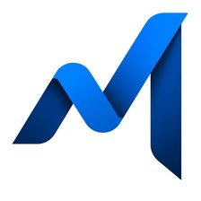
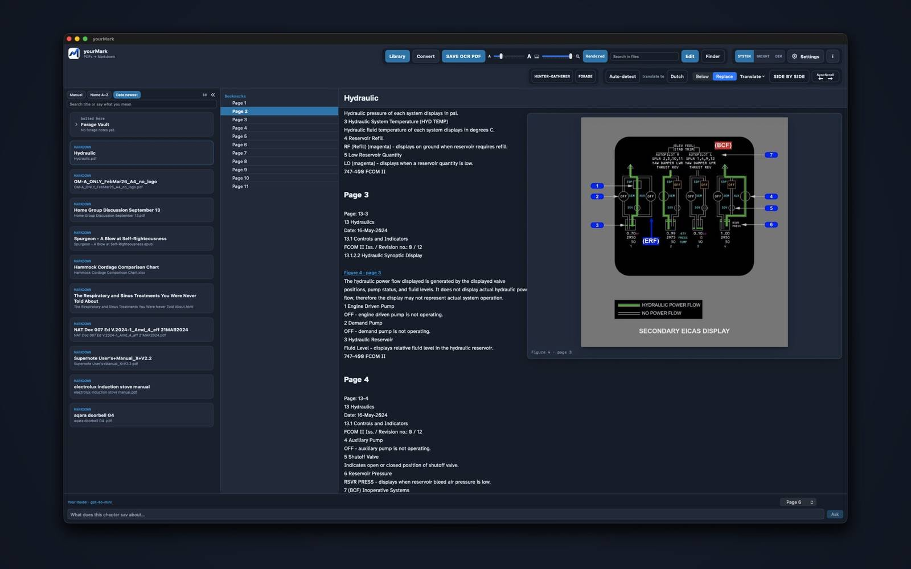
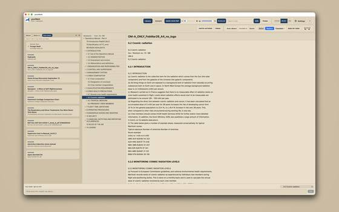
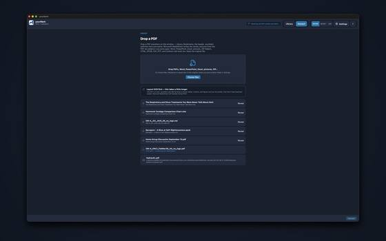
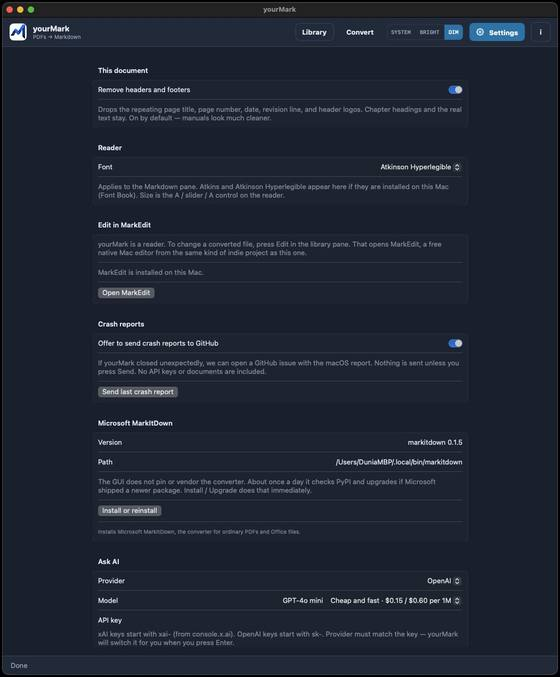
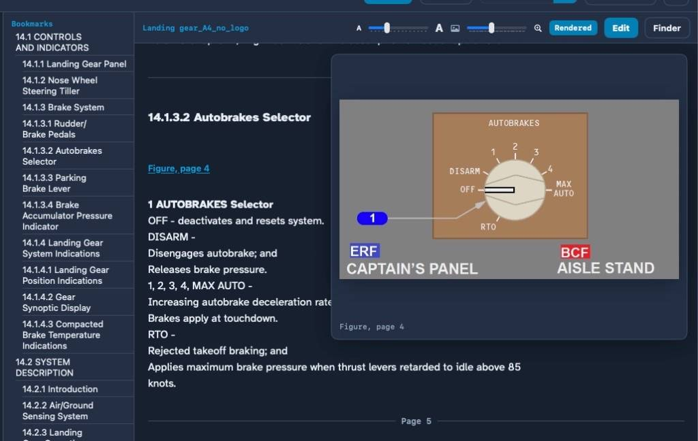
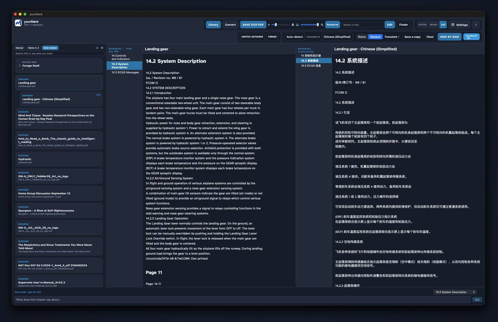
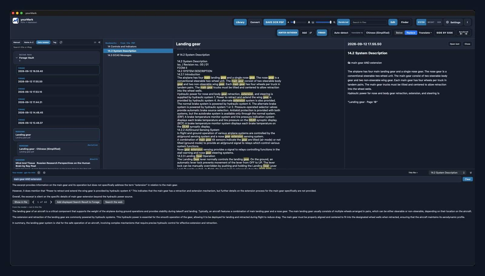
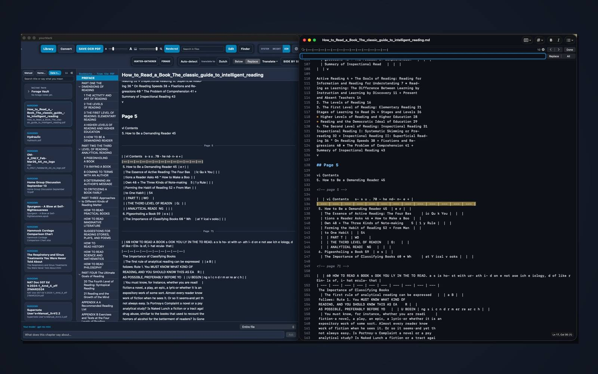
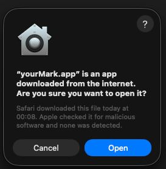

# yourMark and yourMark CLI

<p align="center">
  
</p>

A Mac app that turns PDFs — and Word, slides, or a spreadsheet — into **Markdown**. That is ordinary text you can search, copy, ask about, translate, and share with an AI. The file never leaves this computer unless you press Ask or Translate. You can export that Markdown as an EPUB.

## Downloads

**yourMark (Mac app)**

[Download yourMark-0.6.4.dmg](https://github.com/Burbank/yourMark/releases/latest/download/yourMark-0.6.4.dmg) · [yourMark AI on the Mac App Store](https://apps.apple.com/us/app/yourmark-ai/id6811011164?mt=12)

**yourMark CLI**

[Download yourmark-cli-0.6.4-macos.zip](https://github.com/Burbank/yourMark/releases/latest/download/yourmark-cli-0.6.4-macos.zip)

yourMark CLI is a separate download. It is not inside the app or the App Store version.

[All versions](https://github.com/Burbank/yourMark/releases) · [Install notes](INSTALL.md)

[Test a simpler version in your browser](https://burbank.github.io/yourMark/) (preview only — no OCR)

The GitHub disk is named **yourMark**. The Mac App Store listing is **yourMark AI** (the short name was taken). Same app, two channels.

The window is **US English**, **Spanish**, or **Dutch**. Lock an Ask AI key in Settings if you want more interface languages.

## yourMark and yourMark CLI

**yourMark** is the Mac app. It is on the Mac App Store as **yourMark AI**, and it is a direct download on the GitHub disk. Drop in a PDF, Word file, slides, or a spreadsheet. The words become Markdown on this Mac.

**yourMark CLI** is the same converter, for Terminal. It belongs to the direct download. The App Store app is sandboxed, so it cannot run OCRmyPDF, Tesseract, Docling, or other programs you installed on the Mac. In that build yourMark CLI prints `yourmark CLI is not available in the App Store build.` and exits 4.

| | App Store app | GitHub disk | yourMark CLI |
| --- | --- | --- | --- |
| Name | yourMark AI | yourMark | `yourmark` |
| What you get | The window | The window | `convert`, `probe`, `doctor` |
| Sandbox | Yes. yourMark CLI exits 4 | No | No |
| Scan OCR | Apple Live Text | Optional Docling and OCRmyPDF | Vision, or OCRmyPDF + Tesseract |

### Download and install yourMark CLI

yourMark CLI is a separate download. It is not inside the app or the App Store version. You need macOS 14 or later. The zip is a universal binary (Apple silicon and Intel).

1. Download [yourmark-cli-0.6.4-macos.zip](https://github.com/Burbank/yourMark/releases/latest/download/yourmark-cli-0.6.4-macos.zip).
2. Check the SHA-256 against [yourmark-cli-0.6.4-macos.sha256](https://github.com/Burbank/yourMark/releases/latest/download/yourmark-cli-0.6.4-macos.sha256).
3. Unzip the archive. The file inside is `yourmark`.
4. Move `yourmark` to `~/.local/bin` or `/usr/local/bin`.
5. Run `yourmark doctor`.

```sh
curl -fsSL -o yourmark-cli-0.6.4-macos.zip https://github.com/Burbank/yourMark/releases/latest/download/yourmark-cli-0.6.4-macos.zip
curl -fsSL -o yourmark-cli-0.6.4-macos.sha256 https://github.com/Burbank/yourMark/releases/latest/download/yourmark-cli-0.6.4-macos.sha256
shasum -a 256 -c yourmark-cli-0.6.4-macos.sha256
unzip yourmark-cli-0.6.4-macos.zip
mkdir -p "$HOME/.local/bin"
mv yourmark "$HOME/.local/bin/yourmark"
# or: sudo mv yourmark /usr/local/bin/yourmark
yourmark doctor
```

Put `$HOME/.local/bin` on your PATH if you use that folder.

### Build from source

To build yourMark CLI from this repository instead, you need Swift 6 (Xcode). That copy is not notarized.

```sh
swift build -c release --product yourmark-cli
mkdir -p "$HOME/.local/bin"
cp .build/release/yourmark-cli "$HOME/.local/bin/yourmark"
```

The built file is named `yourmark-cli`. Copying it to `yourmark` matches the help text (`yourmark --help`). If `.build/release/yourmark-cli` is not there, use `.build/out/Products/Release/yourmark-cli`.

### Requirements

- **macOS 14** or later. Apple Vision is part of that system. `yourmark doctor` reports it as available.
- **OCRmyPDF and Tesseract** are optional, from Homebrew. OCRmyPDF is what runs Tesseract: `brew install ocrmypdf`
- **Docling** is optional, through uv: `uv tool install docling`

`--ocr-engine auto` uses OCRmyPDF when that program is installed, and Apple Vision otherwise. `--ocr-engine vision` stays on Apple Vision. `--ocr-engine tesseract` uses OCRmyPDF + Tesseract when `ocrmypdf` is installed, and Apple Vision when it is not.

### Examples

```sh
yourmark convert paper.pdf --out ~/Documents/yourMark
yourmark probe paper.pdf
yourmark doctor
yourmark convert scan.pdf --out ~/Documents/yourMark --ocr on --ocr-engine tesseract --layout off
yourmark convert paper.pdf --out ~/Documents/yourMark --images on --json --timeout auto --max-pages 1500 --max-mb 100
```

`yourmark fetch https://example.com/paper.pdf --out ~/Downloads` downloads an HTTPS file. An `http://` address is rejected.

`--out` is required for `convert`. It is the library folder. yourMark CLI makes one folder inside it, named after the file.

### Flags

| Flag | Values | Default |
| --- | --- | --- |
| `--ocr` | `auto`, `on`, `off` | `auto` |
| `--ocr-engine` | `auto`, `vision`, `tesseract` | `auto` |
| `--layout` | `auto`, `docling`, `off` | `auto` |
| `--images` | `on`, `off` | `off` |
| `--json` | on/off flag | off |
| `--timeout` | seconds, or `auto` | `auto` |
| `--max-pages` | a page count | 1500 |
| `--max-mb` | megabytes | 100 |

`--layout auto` puts the body first and sidebars after it, without splitting words. `--layout off` leaves the converter's own order. `--layout docling` asks Docling for the reading order.

`--timeout auto` waits 120 seconds, plus 3 seconds per page, plus 20 seconds per page that needs OCR. It is never under 120 seconds and never over 3600.

Also from `yourmark convert --help`: `--ocr-lang` is `auto`, `eng`, `nld`, `spa`, or `hun` (default `auto`). `--keep-original` is `auto`, `always`, or `never` (default `auto`). `--dry-run` checks the file and does not convert.

### One folder

```text
~/Documents/yourMark/paper/
  paper.md
  paper.outline.json
  figures/figure-001.jpg
  paper.pdf
```

`paper.md` is the Markdown. `paper.outline.json` is the outline. `figures/` holds pictures when they are extracted (`figure-001.jpg` and so on; the extension follows the picture). `--images` defaults to off. A photograph of a whole scanned page is not stored as a figure. `paper.pdf` is the original file, copied in when `--keep-original` is `always`, or when it is `auto` and OCR was weak.

### Exit codes

| Code | Meaning |
| --- | --- |
| 0 | Success |
| 1 | Partial. The Markdown was written, with warnings. Weak OCR is one of those warnings. |
| 2 | Rejected input: size, page count, encryption, an `http://` URL, or a bad flag |
| 3 | Conversion failed |
| 4 | Engine missing. The App Store stub also exits 4. |
| 5 | File or output error |
| 124 | Timed out |

### Old type

Blackletter and other very old type is flagged as weak OCR rather than accepted as a clean reading. The Markdown is still written. Weak means the average confidence is under 0.6, or the OCR text has fewer than 200 characters per page. The warning is `OCR quality is below the threshold`, the exit code is 1, and `--keep-original auto` keeps the original PDF in the folder.

## Why Markdown?

A PDF is a picture of a page. Markdown is the words, in order.

That is why it works so well with AI. A model can read a chapter and quote the words that are there. If that chapter does not have the answer, it can say so — instead of guessing at a scan. Paste a heading into Grok or ChatGPT, keep notes, or search a whole course. Tables stay tables. Headings stay an outline.

Keep the original PDF. Markdown is the working copy.

## A look inside

- **Convert** — drop a PDF, Word, slides, or Excel. The words are written on your Mac, not online. A `.md` you already have skips the converter: File → Open, drop it, or put it in the folder you chose. Rendered shows headings and tables as a grid. Make EPUB writes an EPUB next to the Markdown.
- **Library** — file on the left, bookmarks in the middle, the text on the right. Search in files stays on this Mac. Ask a chapter at the bottom if you add a key.
- **Translate** — From and To in the reader. A Google Translate key or an Ask AI key is enough; you do not need both. Below keeps the original; Replace shows only the translation. **SIDE BY SIDE** opens both languages and they can scroll together.
- **Hunter-Gatherer / FORAGE** — select text, press Enter, keep clips on a dated note beside the reader. Headings and tables match the rendered reader. A drag across cells keeps the table.
- **Settings** — choose the folder once (iCloud if you want). New Markdown in that folder appears in the library. Interface language is US English, Spanish, or Dutch — an Ask AI key can add more. Bright, Dim, or System in the header; your keys; extra help for scanned pages.

yourMark is the window. [Microsoft MarkItDown](https://github.com/microsoft/markitdown) does the converting, on this Mac. If Microsoft publishes an update, yourMark can install it for you.

Needs **macOS 14** or later. Open the disk and **drag yourMark onto Applications** (follow the arrow). Do not keep working from the disk — if you do, yourMark will copy itself into Applications so ejecting is safe. The first launch installs MarkItDown if it is missing. The first window asks where converted files should live.

This Mac disk is signed and notarized by Apple. Open yourMark from Applications.

[Privacy](https://burbank.github.io/yourMark/privacy.html) · [Apple distribution](docs/apple-distribution.md) (notarized GitHub disk and Mac App Store)

## Pictures of the window

<br>



<br>

Library at night — files, bookmarks, and the text. Pictures are blue links; hover to see them. Ask a chapter underneath.

<br>

|  |  |  |
| --- | --- | --- |
| Library · Bright — three columns on paper. | Convert — drop a PDF. Nothing is uploaded. | Settings — folder, colours, MarkEdit, and your keys. |

<br>



<br>

Pictures are blue links, not the photo in the page. Hover over a link to see it. Use the slider to adjust the preview size.

<br>

## Translate

<br>



<br>

Lock a **Google Translate** key or an **Ask AI** key in Settings — either one shows the translate buttons. Pick **From** and **To**. **Below** keeps the original under each paragraph. **Replace** shows only the translation. This chapter is the cheap way; Entire file sends more text.

**SIDE BY SIDE** opens the pair. **SyncScroll** keeps the headings together. Save a copy writes a second file (for example `Manual.es.md`). The original Markdown is not overwritten. Convert still stays on this Mac. Google Translate is incredibly fast.

**Hunter-Gatherer** is for clipping as you read. Select text and press Enter: each piece keeps its chapter and page and lands on a dated **FORAGE** note beside the reader. Press **FORAGE** to keep that note open while you change files. After Ask, **Add displayed Search Result to Forage** keeps the line you found — and your question — on today’s note.

<br>

## Ask

<br>



<br>

Paste a Grok or OpenAI key in Settings. Ask the open chapter, or the start of the file. AND, OR, and NOT must be capitals, and the words must sit in the same sentence or paragraph. Recent Asks stay on this Mac.

Search in files is separate — it finds words on every library card and is never sent to the AI.

<br>

## Changing the text

yourMark is a **reader**. To change the file, press **Edit**. That opens [MarkEdit](https://github.com/MarkEdit-app/MarkEdit), a free Mac editor. Get it from Settings if it is not installed. You do not need a GitHub account. Saves in MarkEdit show up here.

<br>



<br>

yourMark on the left. MarkEdit on the right. Press Edit; what you save there shows up here.

**Show in Finder** highlights the little folder when there are pictures (Markdown plus `figures`). Right-click that folder, compress it, and send the zip to your favourite AI. If there are no pictures, it highlights the `.md`.

<br>

## What you get

| You asked | What you actually get |
|-----------|------------------------|
| **Tables** | Yes, when the PDF has a real table. Colours and merged cells become plain cells. |
| **Pictures** | The photos that were inside the PDF, next to that page. We do not add photographs of whole text pages. The Markdown and a `figures` folder sit together in a little folder named after the file. |
| **Headers / footers** | **Remove headers and footers** in Settings (on by default) drops repeating page titles, page numbers, dates, and header logos. Chapter titles like 8.1 stay. |
| **Bookmarks** | The same outline Preview shows becomes headings in the Markdown. Numbered titles (8.1, 8.1.1) become headings too. |
| **Other files** | Word, PowerPoint, Excel, web pages, EPUB, CSV, mail, RTF, ZIP (each file inside), and photos. Ready `.md` files skip the converter. |

## Install

### Mac version, most complete

Download the disk image, drag **yourMark** onto **Applications** (follow the arrow), then open it. First launch installs Microsoft MarkItDown. Then choose a folder for converted files — this Mac, iCloud, or anywhere you like.

<p align="center">
  
</p>

The first open may show this. That is normal. Click **Open**. The dim line is Apple saying it already scanned the disk — yourMark is notarized.

**Homebrew (optional):**

```sh
brew tap Burbank/yourMark
brew install --cask yourmark
```

**From source:** `./Scripts/Install.command`

### Windows (early)

[Download yourMark.exe](https://github.com/Burbank/yourMark/releases/latest/download/yourMark.exe). No library, bookmarks, or Ask. Same Microsoft converter.

1. Double-click **yourMark.exe**. You do not need Python.
2. If Windows says **Windows protected your PC**, click **More info** → **Run anyway**.
3. Choose a PDF (or Word, slides, Excel), then **Convert**. A folder opens with the Markdown.
4. To edit, use [MarkText](https://github.com/marktext/marktext) (free, open source). MarkEdit is Mac-only. The exe has a **Get MarkText** button.

More in [`windows/`](windows/README.md).

## License

yourMark is MIT. MarkItDown is MIT, from Microsoft. Not an official Microsoft product.
